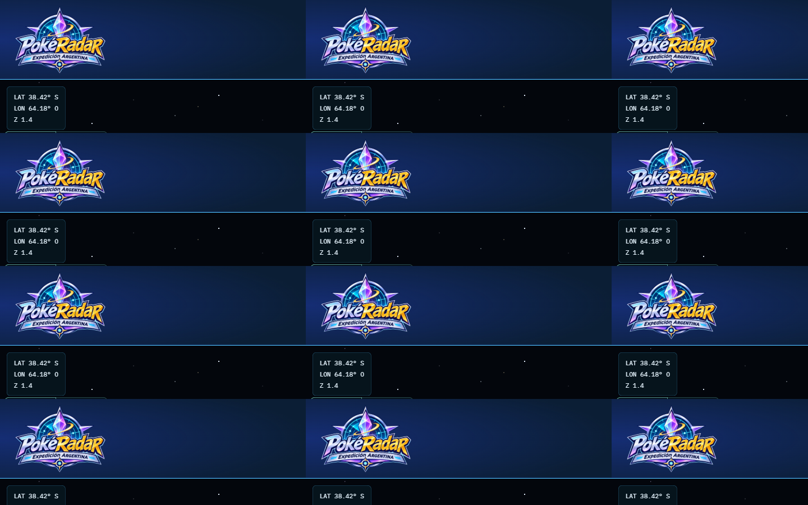

# PokéRadar — Expedición Argentina



Radar de exploración Pokémon sobre el mapa real de Argentina. Las fichas salen de [PokéAPI](https://pokeapi.co/). Las posiciones son encuentros simulados de Kanto por hábitat; no son apariciones reales.

**Producción:** pendiente de la URL pública del despliegue.

## Cómo ejecutarlo

Node.js 20+ y npm. No requiere autenticación.

```bash
npm ci
npm run dev
```

Abrí [http://localhost:3000](http://localhost:3000).

```bash
npm run build
npm start
```

`predev` / `prebuild` copian el worker de MapLibre a `public/`.

**Cómo probarlo:** al entrar hay una intro omitible (Saltar / Escape). Desde la cabecera están Pokédex, Medallas, sonido y Bitácora. En la Pokédex, **Probar expedición completa** y en Medallas **Probar demostración** simulan logros en memoria sin tocar el progreso real. **Reiniciar expedición** borra el progreso local tras confirmación.

**Calidad:** `npm run lint`, `npm run typecheck`, `npm run build` y los verificadores en `scripts/` (PokéAPI, progreso, captura, clima, equipo, mapa, enclaves y demos).

---

## 1. Concepto y narrativa

PokéRadar invita a recorrer Argentina en un globo, acercar regiones y descubrir criaturas de Kanto como señales de un radar. Elegimos el país por su geografía diversa (ciudad, bosque, montaña, costa, hielo, islas) y porque el brief pedía un escenario local navegable.

**Qué incluye la experiencia**

- 56 especies de Kanto: 50 en el campo y 6 en enclaves reservados.
- Diez zonas con hábitats de PokéAPI; sellos a zoom amplio y encuentros al acercar.
- Horarios en Buenos Aires, clima vía Open-Meteo, captura, Pokédex y equipo de seis.
- XP, niveles, acabados de carta, medallas, sonido opcional, branding e introducción.

La narrativa diferencia exploración geográfica y descubrimiento gradual (de `???` a la ficha completa), sin pretender avistamientos reales.

---

## 2. Arquitectura y stack

| Tecnología | Uso |
| --- | --- |
| Next.js 16 (App Router) + React 19 | App y UI |
| TypeScript estricto | Tipado (`noUncheckedIndexedAccess`) |
| Tailwind CSS 4 | Estilos |
| MapLibre GL + OpenFreeMap dark | Mapa y globo |
| Framer Motion | Línea del marco y barras de estadísticas; el resto es CSS |
| PokéAPI / Open-Meteo | Fichas y clima |

`src/app` concentra rutas; `components/expedition` la UI del juego; `components/map` el mapa cliente; `lib/` catálogo, progreso, PokéAPI y estilo geográfico.

**MapLibre sin SSR:** `MapCanvas` es Client Component y carga `MapView` con `dynamic(..., { ssr: false })`. Así el bundle de MapLibre no se evalúa en el servidor y se evita `window is not defined`. El mapa se crea en `useEffect` y se destruye al desmontar.

Persistencia en `localStorage` (progreso, equipo, medallas, acabados) y `sessionStorage` (proyección, audio, intro). Estados de carga y error en mapa, fichas, clima y límites de ruta. Accesibilidad: Escape, foco al cerrar, reduced motion y layout adaptable a móvil.

**Atribuciones:** OpenFreeMap / MapLibre; contornos Natural Earth 5.1.2; datos y sprites PokéAPI; clima Open-Meteo; relieve del preview de desarrollo Terrain Tiles (Mapzen, CC BY 4.0). Ilustraciones de enclaves: originales con IA bajo dirección humana. Pokémon pertenece a sus titulares; este proyecto es una simulación demostrativa.

---

## 3. Uso de inteligencia artificial

El desarrollo fue AI-native con Cursor: implementación, contraste de APIs y borradores de verificadores. Las propuestas del modelo se validaron siempre con mapa, consola, scripts o capturas; no se aceptaron a ciegas.

1. **Marcadores y CSS** — Sellos que no recibían clic o se desplazaban. MapLibre dejaba subir el `mousedown` y reglas de `position`/`display` afectaban el hit area. Se detectó al probar Iguazú y Moreno en escritorio. Se cortó el pointer en el sello y se alineó Enter/Espacio con la misma acción, sin mover coordenadas.

2. **Mapa que no arrancaba / worker** — El mapa quedaba en carga. Turbopack rompía el worker (`import.meta.url`) y `ssr: false` no podía vivir en un Server Component. Se movió el `dynamic` al Client Component y se copia un worker estático en `predev`/`prebuild`.

3. **UX de cartas y enclaves** — Franjas, scroll y botones fuera de viewport en 390 px o ventanas bajas. Se midió en Chrome con tamaños fijos; la visita de enclave pasó a pantalla completa con el arte en proporción fija y la narración encima.

La dirección del producto (qué se simula, qué se persiste y qué queda en demo) fue humana.

---

## 4. Próximos pasos

1. Pruebas E2E (intro, Pokédex, captura) además de los scripts actuales.
2. Comprimir logo e ilustraciones; cuidar LCP de la cabecera.
3. Auditoría de foco/Tab en álbum y enclaves.
4. Pasada en teléfono real y pulido de bitácora/equipo en 390 px.
